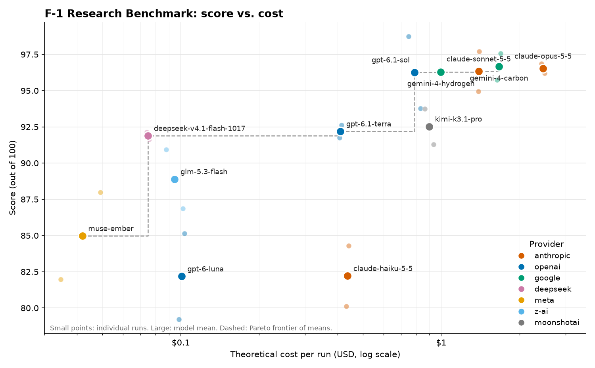

# F-1 Research Benchmark

A benchmark for LLM agents doing policy research on the U.S. Federal Register. The agent plays a researcher at a university international student office. Its job is to answer 16 questions about the DHS final rule that ended "duration of status" (D/S) admission for F-1 students. The questions cover the rule's text and the proposed rules, notices and presidential documents around it. The agent gets only Federal Register search and reading tools, and its answers are graded against a confidential answer key.

The task states the world as of **November 14, 2026**. The 16 questions are worth 100 points in total.

## What it tests

- Finding the governing documents in a large corpus, and reading long regulatory text closely.
- Applying rule provisions to concrete student scenarios, with date arithmetic shown.
- Telling the kinds of authority apart: final rule text, preamble, commenters, proposed rules and presidential documents.
- Flagging gaps honestly where the text is silent. TASK.md says a confident unsupported answer is worse than a flagged gap.
- Avoiding stale or wrong sources. Some pending proposals look relevant but are not in force.

## Results



## Layout

| Path | Purpose |
|---|---|
| `tasks/<name>/` | One folder per task. The F-1 task is `tasks/f1/`, the default. |
| `tasks/<name>/TASK.md` | The agent's only instructions: role, tools, ground rules and the questions. |
| `tasks/<name>/ANSWER_KEY.md` | Confidential reference answers. **Never show it to the agent under test.** |
| `tasks/<name>/rubric.toml` | Machine-readable criteria derived from the answer key, with points, caps, gates and penalties. |
| `tasks/<name>/runs/` | Output of runs and grades (committed). |
| `bench.py` | Runs the agent on a task's `TASK.md` and records structured answers. |
| `grader.py` | Grades a run against its task's `ANSWER_KEY.md` and `rubric.toml`. |
| `harness_common.py` | Shared code: the agent loop (OpenAI Responses API), the FR function tools, transcript recording. |
| `fr_tool.py` | The Federal Register search/read tool (`search`, `doc`, `toc`, `text`, `grep`). Standard library only. |
| `corpus/` | Frozen snapshot of the documents (`<doc-number>.txt` plus `.json` metadata), shared by all tasks. |
| `analysis/pricing.csv` | Per-model token prices (USD per 1M tokens), by context tier. |
| `analysis/theoretical_cost.py` | Computes each run's theoretical cost from its transcript and `pricing.csv`; writes `analysis/runs_theoretical_cost.csv`. |
| `analysis/` | `plot_cost_vs_score.py` plots score against cost; outputs `cost_vs_score.png` and `model_summary.csv`. |

## Setup

Requires Python 3.13+ and [uv](https://docs.astral.sh/uv/).

```bash
uv sync
```

Create a `.env` in the repo root (gitignored):

```
OPENAI_API_KEY=...
# optional
OPENAI_BASE_URL=...
FR_TOOL_CACHE=/path/to/cache
```

## Running

Run the agent under test:

```bash
uv run bench.py --model <model-id> --effort high                 # the F-1 task
uv run bench.py --task <name> --model <model-id> --effort high   # another task under tasks/
```

Options (shared with the grader's agent):

| Flag | Meaning |
|---|---|
| `--task` | Task folder name under `tasks/` (default `f1`). The grader takes it from the run. |
| `--model` | Model ID (required). |
| `--effort` | Reasoning effort. |
| `--reasoning-summary` | Reasoning summary mode (default `auto`). |
| `--max-turns` | Turn limit (default 200 for `bench.py`). |
| `--context-budget` | Context budget. Every tool result ends with a line giving the tokens left. The loop asks for the final answer when the turn limit or budget is reached. |
| `--timeout` | Request timeout in seconds (default 3600). |
| `--run-id` | Output folder name (default `<timestamp>_<model>_<effort>`). |

Each run writes to `tasks/<name>/runs/<run-id>/`:

- `transcript.json`: every response, tool call, tool result and token usage.
- `answer.json`: the structured final answer.
- `answer.md`: the same answer as a Markdown memo. This is what the grader reads.

Each question gets three fields: `answer` (each lettered part, in order), `basis` (citations) and `uncertainty` (or "None").

Grade a run:

```bash
uv run grader.py tasks/f1/runs/<run-id> --model <grader-model> --effort high
uv run grader.py --answer some_answer.md --model <grader-model> --task f1   # grade a Markdown file
uv run grader.py --rescore tasks/f1/runs/<run-id>/grades/<grade-id>         # recompute points from saved verdicts
```

Grader outputs go to `<run>/grades/<grade-id>/` (or `--out`): `transcript.json`, `verdicts.json`, `score.json` and `report.md`. `--cache-ttl {30m,12h}` sets the prompt-cache lifetime for the grading prefix.

## Cost and analysis

```bash
uv run analysis/theoretical_cost.py      # writes analysis/runs_theoretical_cost.csv
uv run analysis/plot_cost_vs_score.py    # writes analysis/cost_vs_score.png and model_summary.csv
```

Both scripts read the F-1 runs in `tasks/f1/runs/`. Theoretical cost assumes every cacheable token is a cache hit and every new token (user prompt, tool results) is a miss. Prices come from `pricing.csv`, with context-size tiers where a provider has them.

## The Federal Register tools

The agent has five function tools: `fr_search`, `fr_doc`, `fr_toc`, `fr_grep` and `fr_text`. It has no web access and no other databases (no eCFR, USCIS or SEVP sites). Documents are identified by FR document number, such as `2026-14439`.

The same tools work from the command line:

```bash
uv run fr_tool.py search "duration of status" --type RULE --since 2025-01-01
uv run fr_tool.py toc 2026-14439
uv run fr_tool.py grep 2026-14439 "within 5 months" --context 3
```

### Reproducibility

- The tool reads full texts from the frozen `corpus/` snapshot (`FR_TOOL_SNAPSHOT`) before it checks the cache or the network.
- `FR_TOOL_AS_OF=YYYY-MM-DD` hides every document published after that date. The harness records this value in each run's config.
- A downloaded document joins the snapshot if you copy its `.txt` and `.json` files into `corpus/`.

## Scoring

A task's `rubric.toml` lists criteria for each question, plus criteria applied to every question (such as citations). The grader agent gives each criterion a verdict of `yes`, `no` or `unclear`. It never sees point values. `grader.py` turns verdicts into points:

- **credit** criteria add points on `yes`. **penalty** criteria deduct points on `yes`.
- **gate** criteria carry no points. A group whose gate is not `yes` has its credit multiplied by the group's `factor`.
- **ladders** ("at least 1", "at least 2", ...) count items. Only the unbroken run of `yes` from the first rung counts. A `yes` that breaks the rule is scored as `unclear` and flagged for human review.
- A question's score is credits minus penalties, clamped to `[0, question points]`.
- The headline score counts `unclear` as `no`. `score_min` and `score_max` resolve every `unclear` against or in favour of the submission.

Where `rubric.toml` and the point split in `ANSWER_KEY.md` differ, `rubric.toml` decides.

| Question | Topic | Points |
|---|---|---|
| Q1 | The D/S final rule: citation, dates, docket, RIN, NPRM | 3 |
| Q2 | Authorized stay after program end, transfer timing, OPT filing | 6 |
| Q3 | Admission period, program extension, filing deadlines, work authorization | 8 |
| Q4 | Travel while an I-539 is pending | 5 |
| Q5 | SEVIS transfer from a master's to a PhD program | 7 |
| Q6 | Whether a second master's-level program is allowed | 5 |
| Q7 | The H-1B $100,000 payment, fee proposals, change of status | 8 |
| Q8 | The proposed rule on the 60-day grace period | 4 |
| Q9 | Changes between the proposed and final rule | 3 |
| Q10 | Other documents relevant to post-graduation work | 4 |
| Q11 | Extension-of-stay cost and processing time | 4 |
| Q12 | Timeliness of filing in the 60-day period, employment | 5 |
| Q13 | Travel during the transition period and its effect on stay and OPT filings | 10 |
| Q14 | The OPT fee proposal applied to a STEM OPT extension | 10 |
| Q15 | Checking seven draft statements against the rule text and preamble | 9 |
| Q16 | A six-year program: four-year cap, extension, re-entry, F-2 spouse | 9 |
| | **Total** | **100** |

Q13–Q16 were added after the first round of runs showed Q1–Q12 close to saturated for the strongest models. Q1–Q12 keep their original criteria and internal point split. Each carries `criteria_points` in `rubric.toml`, and `grader.py` scales its credits, caps and penalties to the weight above.

## Notes for maintainers

- Keep every `ANSWER_KEY.md` and `rubric.toml` out of anything the agent can read. `bench.py` gives the agent only the task's `TASK.md` and the FR tools.
- To add a task, create `tasks/<name>/` with `TASK.md` (questions under `### Qn` headings), `ANSWER_KEY.md` and `rubric.toml`, and copy its documents into `corpus/`. A `[grader]` table in the rubric can replace the F-1 wording in the grader's instructions (`finding`, `outside_sources`).
- `TASK.md` should not contain answer-bearing examples. A past commit removed them from the tool examples.
- Not all of the corpus is relevant. It includes proposed rules, a correction and presidential documents that bear on the questions, some only as distractors.
